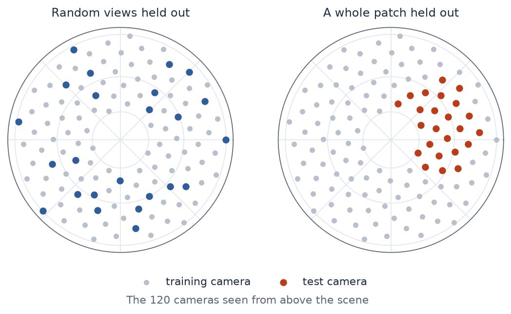
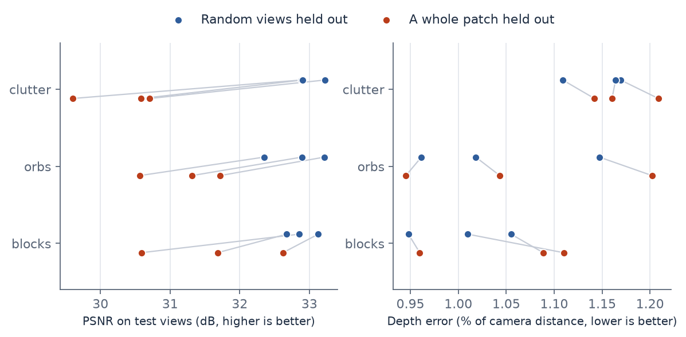

# Novel-View_3D-reconstruction-evaluation

**Does the standard test for novel view synthesis overstate how well a 3D reconstruction
works from directions the camera never went?**

A radiance field is usually scored on test cameras scattered among its training cameras.
This study holds out a whole patch of viewing directions instead, on scenes where the
exact geometry is known, and measures what changes.



## What was found

48 radiance fields were trained on three synthetic scenes. The full write-up is in
[REPORT.md](REPORT.md); the plan written before the runs is in [PLAN.md](PLAN.md).

| | Random views held out | A whole patch held out |
|---|---|---|
| PSNR on test views | 32.9 dB | 31.0 dB |
| SSIM | 0.978 | 0.963 |
| Depth error, % of camera distance | 1.06 | 1.10 |
| Silhouette IoU | 0.989 | 0.989 |

- **The standard test was optimistic by 1.9 dB of PSNR** (95% interval 1.3 to 2.4), in all
  nine paired comparisons. Both designs fitted their training views equally well (33.1 dB).
- **The geometry barely moved.** Depth error rose 3% while image error rose 56%. I had
  predicted the opposite, and that prediction failed.
- **Image quality fell steadily with distance from the training cameras:** 32.7 dB at 10
  degrees from the nearest one, 29.7 dB beyond 26 degrees.
- **Camera poses recovered from the images alone were nearly as good as the true ones:**
  all 120 cameras registered on every scene, about 0.1 degrees of rotation error, and a
  mean cost of 0.5 dB.
- Two of five predictions held, one failed, one was inconclusive and one held on average
  but not in every run. The report says which.



These are three small synthetic scenes and one small model trained on a CPU. The size of
the effect should not be quoted for real captures or for stronger models.

## What is in the repository

Everything is written from scratch around PyTorch, NumPy and OpenCV primitives.

| Part | File | What it does |
|---|---|---|
| Scenes | `src/viewgap/scenes.py` | Procedural scenes of boxes and spheres, ray traced analytically, with exact depth for every pixel |
| Cameras | `src/viewgap/cameras.py` | Pinhole cameras on a hemisphere, ray generation |
| Radiance field | `src/viewgap/field.py` | Two feature grids, a small decoder, volume rendering, occupancy-grid sample skipping |
| Structure from motion | `src/viewgap/sfm.py` | SIFT matching, essential-matrix RANSAC, tracks, PnP registration, triangulation, sparse bundle adjustment, similarity alignment |
| Test designs | `src/viewgap/splits.py` | `random` and `cap` hold-outs of equal size |
| Metrics | `src/viewgap/metrics.py` | PSNR, SSIM, depth error, silhouette IoU |
| Experiments | `src/viewgap/suite.py` | The run matrix, a resumable runner, paired bootstrap statistics |
| Figures | `src/viewgap/figures.py` | Every figure in this README and the report |

## Reproduce it

You need Python 3.11 or newer and [uv](https://docs.astral.sh/uv/). No GPU is used. Times
are from an 8-core desktop.

```bash
git clone https://github.com/AmosBunde/Novel-View_3D-reconstruction-evaluation
cd Novel-View_3D-reconstruction-evaluation
uv sync                      # installs CPU PyTorch, OpenCV, SciPy
uv run pytest -q             # 14 tests, a few seconds
```

Then, in order:

| Step | Command | Time | Writes |
|---|---|---|---|
| 1. Render the scenes | `uv run viewgap render` | about 15 min | `data/` (0.4 GB, not in git) |
| 2. Recover camera poses | `uv run viewgap sfm` | 10 to 20 min | `results/sfm/` |
| 3. Train one field, to check the setup | `uv run viewgap one --scene clutter --design random` | about 4 min | `results/runs/` |
| 4. Run every experiment | `uv run viewgap suite --workers 2` | about 1.5 hours | `results/runs/`, `results/examples/` |
| 5. Compute the statistics | `uv run viewgap summarise` | seconds | `results/summary.json`, `results/per_run.csv` |
| 6. Draw the figures | `uv run viewgap figures` | seconds | `docs/img/` |

Step 3 should print a test PSNR close to 32.9 dB. Step 4 skips any run whose result file
already exists, so it can be stopped and restarted. The result files from my runs are
committed, so steps 5 and 6 work straight after cloning (step 6 also needs step 1, because
two figures show the rendered scenes).

Seeds are fixed, but CPU thread scheduling makes PyTorch results differ slightly between
machines. Expect PSNR within a few tenths of a dB of the committed numbers, not identical.

## Reading the results yourself

- `results/per_run.csv`: one row per run with the four metrics.
- `results/runs/*.parquet`: one row per rendered view, including the angle from each test
  camera to its nearest training camera.
- `results/summary.json`: every number quoted in the report.
- `results/sfm/*.json`: pose errors for each scene.

## Limits

- Synthetic scenes of one kind, 128 x 128 pixels, object-centred cameras.
- One small model. It is a compact member of the voxel-grid family, not a new method and
  not a strong baseline.
- Nine paired comparisons for the main result; one seed for the sparse-view, recovered-pose
  and ablation experiments.
- The plan was written before the experiments ran but was not registered anywhere, and its
  author also ran the experiments.

## Licence

MIT. See [LICENSE](LICENSE).
