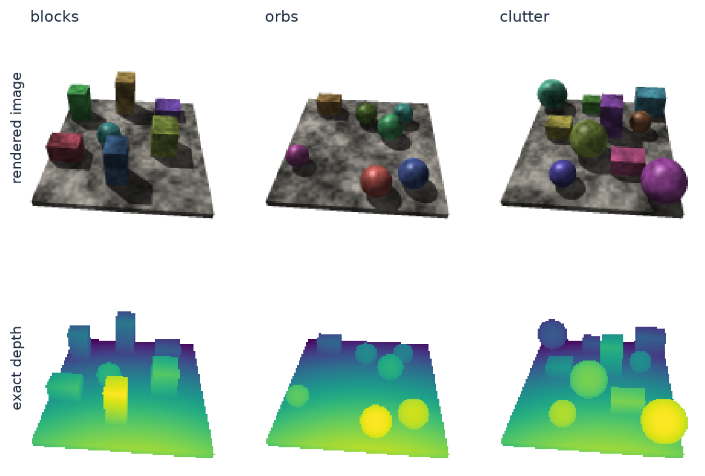
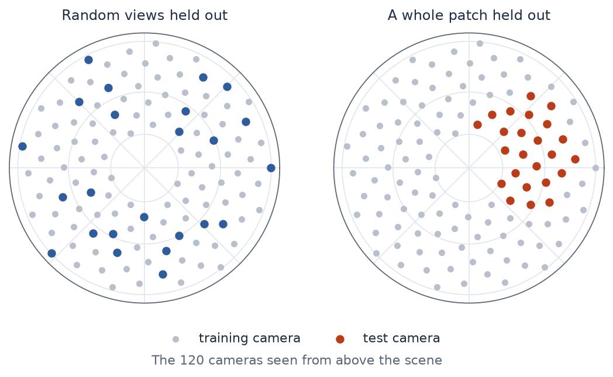
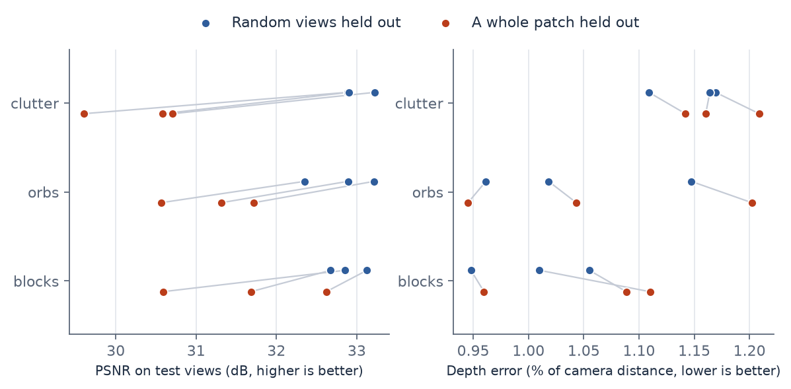
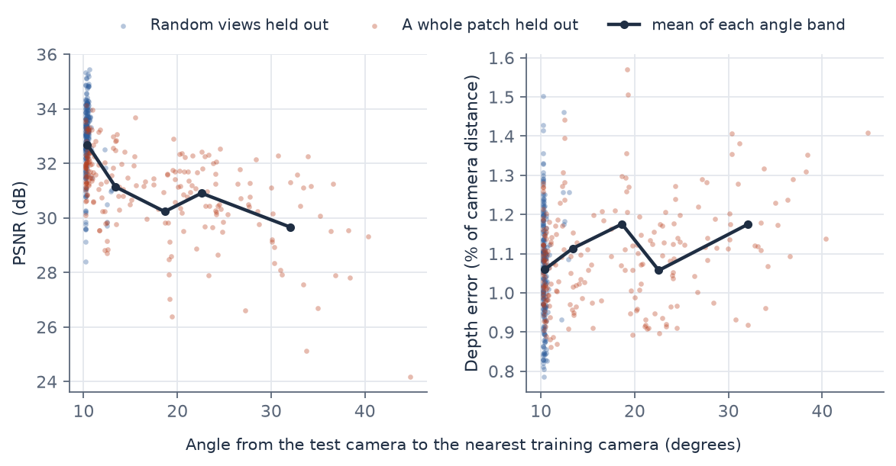
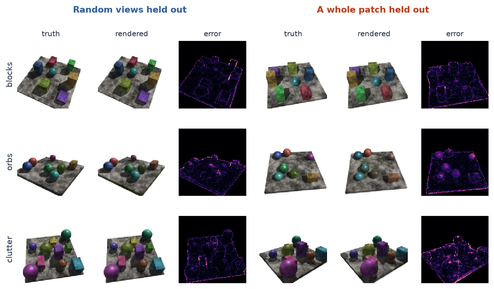
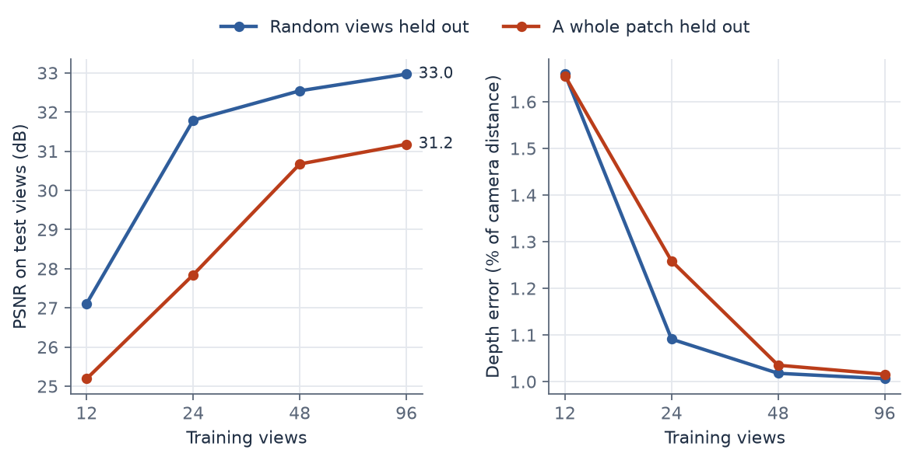
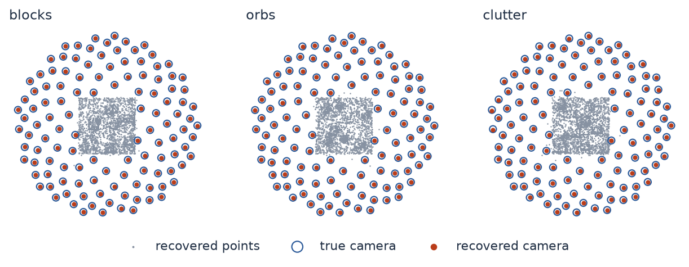

# How much does the usual held-out-view test flatter a radiance field?

Amos Bunde, November 2026

## Summary

Novel view synthesis is scored on test cameras that sit among the training cameras. I
compared that test with one that holds out a contiguous patch of viewing directions, using
the same model, the same number of training and test views, and scenes with exact depth.

Across nine paired runs the usual test reported 32.9 dB PSNR and the patch test 31.0 dB, a
difference of 1.9 dB (95% interval 1.3 to 2.4). Image quality fell steadily as test cameras
moved away from the nearest training camera. Depth accuracy did not: depth error rose by
3% while image error rose by 56%, which contradicts what I predicted. A follow-up ablation
shows that view-dependent colour explains only a small part of the gap. Camera poses
recovered by a structure-from-motion pipeline written for this study cost 0.5 dB on
average.

The study is small: three synthetic scenes, one compact model, CPU training. It shows the
direction of an effect and a way to measure it. It does not establish the size of the
effect for real captures or for current methods.

## 1. Question

A radiance field is fitted to posed photographs and then asked for views it has not seen.
The common protocol takes every eighth image, or a random subset, as the test set. Each
test camera then has training cameras close by on every side, so the model is asked to
interpolate.

People and robots do not move that way. They walk round the back of an object, or look
down from a height nobody photographed. The question is whether the score from the common
protocol says anything about those views, and whether a drop in image score means the
recovered shape has gone wrong or only its appearance.

The same issue is well known for maps and other spatial data, where random test points
that sit beside training points give optimistic accuracy [10]. I had measured it for crop
maps in an earlier study and wanted to see whether it carries over to view synthesis.

## 2. Method

### 2.1 Scenes with exact ground truth

Three procedural scenes (`blocks`, `orbs`, `clutter`) are built from boxes and spheres on
a textured ground slab. A ray tracer written for the study intersects each camera ray
with the primitives analytically, so every pixel has an exact depth and an exact
surface-or-background label. Shading is Lambertian with hard shadows, and spheres have a
specular highlight, so their colour changes with viewing direction. Each scene is rendered
from 120 cameras spread evenly over a band of the upper hemisphere (15 to 70 degrees of
elevation), all looking at the scene centre from a distance of 3 units. Neighbouring
cameras are about 10 degrees apart.

Synthetic scenes were chosen for one reason: depth error can be measured against the truth
rather than against another algorithm's estimate.

### 2.2 The two test designs

Both designs hold out 24 cameras and train on 96.

- **Random.** 24 cameras drawn at random. Every test camera is 10 to 13 degrees from its
  nearest training camera.
- **Cap.** One camera is drawn at random and the 24 cameras nearest to it in viewing
  direction are held out together. Test cameras are 10 to 45 degrees from the nearest
  training camera (median 15).

### 2.3 The model

One model is used for every run: a compact voxel-grid radiance field in the family of
DVGO [3] and Plenoxels [4]. Two feature grids (40 cubed with 8 channels, 96 cubed with 4)
are sampled trilinearly. A small network turns the features into density and a geometry
code; a second turns that code and the viewing direction (degree-2 spherical harmonics)
into colour. Images are formed by standard volume rendering [1] with 64 stratified samples
per ray. An occupancy grid computed from the model's own density skips empty space, as in
Instant-NGP [2]. Training is 1,000 Adam steps of 2,048 rays with a total-variation
regulariser on the fine grid, and takes under four minutes on four CPU threads.

This is not a new method and not a strong one. It was sized so that 48 runs fit on a
desktop. No setting was tuned per scene, per design or per run.

### 2.4 Camera poses from the images

To check the result does not depend on being handed perfect poses, I wrote an incremental
structure-from-motion pipeline, following the usual structure [5]: SIFT features [7],
ratio-test matching over all image pairs, five-point essential-matrix RANSAC [8], tracks
built by union-find, an initial two-view reconstruction, PnP registration of further
cameras, triangulation with a parallax check, and sparse bundle adjustment. OpenCV supplies
the feature detector and the minimal solvers; the pipeline, the track logic and the bundle
adjustment are mine. Recovered poses are aligned to the true frame with a similarity
transform [6] before scoring, since structure from motion fixes neither scale nor origin.

### 2.5 Metrics and statistics

PSNR is the primary metric. SSIM [9], mean absolute depth error on surface pixels and
silhouette IoU are reported beside it. Depth error is given as a percentage of the camera
distance.

Views rendered by one model are not independent, so the unit of analysis is the run.
Differences between designs are paired within (scene, seed), and intervals are 95%
bootstrap intervals over the nine pairs.

### 2.6 Experiments

| | Runs | What varies |
|---|---|---|
| E1 | 18 | 3 scenes x 2 designs x 3 seeds; 96 training views; true poses |
| E2 | 18 | 3 scenes x 2 designs x {12, 24, 48} training views; seed 0 |
| E3 | 6 | 3 scenes x 2 designs; poses from structure from motion; seed 0 |
| E4 | 6 | 3 scenes x 2 designs; colour that ignores viewing direction; seed 0 |

E1 to E3 and five hypotheses were written down in [PLAN.md](PLAN.md) before the runs. E4
was added afterwards and is exploratory.

## 3. Results

### 3.1 The usual test is optimistic (H1: supported)

| Metric | Random | Cap | Cap worse by (95% interval) |
|---|---|---|---|
| PSNR, dB | 32.90 | 31.04 | 1.86 (1.34 to 2.38) |
| SSIM | 0.978 | 0.963 | 0.015 (0.011 to 0.020) |
| Depth error, % of camera distance | 1.06 | 1.10 | 0.03 (0.01 to 0.05) |
| Silhouette IoU | 0.989 | 0.989 | 0.000 (-0.003 to 0.003) |

The cap design scored lower PSNR in all nine pairs. The plan asked for at least 1 dB with
an interval excluding zero, and that was met. The gap differs by scene: 1.3 dB on
`blocks`, 1.6 dB on `orbs`, 2.7 dB on `clutter`, the scene with the most occlusion.

The models fitted their training views equally well under both designs (33.09 and 33.06
dB), so the gap is not a difference in how well training went.

### 3.2 Quality falls with distance from the training cameras (H2: supported)

Within every one of the nine cap runs, per-view PSNR was negatively correlated with the
angle to the nearest training camera (mean Spearman correlation -0.56, interval -0.65 to
-0.46). Pooled over E1:

| Angle to nearest training camera | Test views | PSNR, dB | Depth error, % |
|---|---|---|---|
| 9 to 12 degrees | 288 | 32.7 | 1.06 |
| 12 to 16 | 40 | 31.1 | 1.11 |
| 16 to 20 | 22 | 30.2 | 1.18 |
| 20 to 26 | 45 | 30.9 | 1.06 |
| over 26 | 37 | 29.7 | 1.17 |

The random design never produces a test camera more than 13 degrees from a training
camera. It cannot see this curve at all.

### 3.3 The geometry held up (H3: failed)

I predicted that depth would suffer proportionally more than appearance. It was the other
way round. Depth error in the cap design was 1.03 times that of the random design
(interval 1.01 to 1.05). Image mean squared error was 1.56 times (1.38 to 1.76).
Silhouettes were unchanged.

So when this model is asked for a view from an unvisited direction, it puts surfaces in
nearly the right place and paints them less accurately. The error images show the loss
spread across textured surfaces and edges rather than concentrated in misplaced objects.

A practical reading: on these scenes, the image score from the usual test overstates how
good the pictures will be elsewhere, but its implied message about shape is roughly right.
Across all E1 test views PSNR and depth error are only moderately related (Spearman
-0.50), so PSNR is a weak stand-in for geometric accuracy in either design.

### 3.4 Why appearance and not shape? (E4: exploratory)

One explanation is that colour which depends on viewing direction has been fitted only for
directions near the training cameras, and extrapolates badly. If so, removing the viewing
direction from the colour network should close most of the gap.

| Scene | Gap with view-dependent colour, dB | Gap without, dB |
|---|---|---|
| blocks | 0.51 | 0.14 |
| orbs | 1.58 | 1.38 |
| clutter | 3.28 | 3.25 |
| Mean | 1.79 | 1.59 |

It closed about a tenth of it. View-dependent colour is a minor contributor here. This is
one seed per cell, so the per-scene differences are within noise, but the conclusion that
most of the gap remains does not depend on them.

What is left is not explained by this study. My best guess is coverage: parts of surfaces
that face the held-out patch are seen by the training cameras only at grazing angles or
through gaps between objects, so their texture is reconstructed at lower effective
resolution. That fits `clutter` having the largest gap. It could be tested with the exact
scene geometry by counting, for each test pixel, how many training cameras see that
surface point and at what angle. I have not done that.

### 3.5 Fewer training views (H4: not supported)

| Training views | Random, dB | Cap, dB | Gap, dB |
|---|---|---|---|
| 12 | 27.1 | 25.2 | 1.9 |
| 24 | 31.8 | 27.8 | 3.9 |
| 48 | 32.5 | 30.7 | 1.9 |
| 96 | 33.0 | 31.2 | 1.8 |

I predicted the gap would be larger at 12 views than at 96. It was, by 0.1 dB, which is
far less than the spread between seeds in E1, and only one of the three scenes showed it.
I count that as no support. The gap peaked at 24 views instead. A plausible account is
that at 12 views the model is poor everywhere, so there is little left for the cap to
take away, but E2 has one seed and cannot settle it.

### 3.6 Poses recovered from the images (H5: supported on average)

| Scene | Cameras registered | Position error (RMS, % of camera distance) | Rotation error (mean, degrees) | 3D points |
|---|---|---|---|---|
| blocks | 120 of 120 | 0.12 | 0.08 | 3,484 |
| orbs | 120 of 120 | 0.13 | 0.07 | 2,978 |
| clutter | 120 of 120 | 0.21 | 0.12 | 3,639 |

Training on the recovered poses instead of the true ones cost 0.52 dB of PSNR on average
over six runs. Five runs lost less than 1 dB (one gained 0.3 dB); one lost 1.13 dB. The
plan did not say whether "less than 1 dB" meant the mean or every run. On the mean it
holds; on every run it does not. The gap between designs was still present with recovered
poses on `blocks` (0.9 dB) and `clutter` (3.6 dB) and absent on `orbs` (0.2 dB), from one
seed each.

Structure from motion was run at 384 pixels and the fields at 128, and the scenes were
textured so that features could be found. Real captures with blur, reflections or bare
walls are harder.

### 3.7 Scorecard

| | Prediction | Outcome |
|---|---|---|
| H1 | Cap at least 1 dB below random | Supported: 1.86 dB |
| H2 | PSNR falls with angle in at least 8 of 9 cap runs | Supported: 9 of 9 |
| H3 | Depth suffers more than appearance | Failed: 3% against 56% |
| H4 | Gap larger at 12 views than at 96 | Not supported: 0.1 dB, one seed |
| H5 | Recovered poses cost under 1 dB | Mean 0.5 dB; one of six runs over |

## 4. Limits

- **Scenes.** Three synthetic scenes of one kind, at 128 x 128 pixels, with cameras on a
  sphere looking inwards. Nothing here says how large the gap is for real captures,
  unbounded scenes or forward-facing cameras.
- **Model.** One small grid model trained for 1,000 steps. A stronger model, or one with
  learned priors, could narrow the gap or widen it.
- **Sample size.** Nine pairs for E1. E2, E3 and E4 have one seed, and their per-scene
  numbers should be read as indications.
- **The cap.** It removes 24 of 120 cameras from one side. A larger or differently shaped
  hold-out would give a different number.
- **Depth metric.** Expected ray termination depth, averaged over surface pixels. It is
  insensitive to thin errors at object boundaries, which may be where geometry fails first.
- **Planning.** The plan was written before the experiment matrix ran, after one run had
  been used to check the pipeline. It was not registered externally. E4 and the reading of
  H4 and H5 were decided after seeing results and are marked as such.
- **Novelty.** That interpolation is easier than extrapolation is not new, and others have
  studied view-synthesis generalisation at far larger scale. I did not survey that
  literature systematically. The contribution here is a small controlled measurement with
  exact depth, and the code to repeat it.

## 5. What I would do next

1. Test the coverage explanation in 3.4 directly from the scene geometry.
2. Repeat E1 on a public real-capture dataset with measured depth.
3. Vary the size of the held-out patch to trace the whole curve rather than one point.
4. Add seeds to E2 to find out whether the peak at 24 views is real.

## References

1. Mildenhall, Srinivasan, Tancik, Barron, Ramamoorthi, Ng. NeRF: Representing Scenes as
   Neural Radiance Fields for View Synthesis. ECCV 2020.
2. Müller, Evans, Schied, Keller. Instant Neural Graphics Primitives with a Multiresolution
   Hash Encoding. ACM Transactions on Graphics (SIGGRAPH), 2022.
3. Sun, Sun, Chen. Direct Voxel Grid Optimization: Super-fast Convergence for Radiance
   Fields Reconstruction. CVPR 2022.
4. Fridovich-Keil, Yu, Tancik, Chen, Recht, Kanazawa. Plenoxels: Radiance Fields without
   Neural Networks. CVPR 2022.
5. Schönberger, Frahm. Structure-from-Motion Revisited. CVPR 2016.
6. Umeyama. Least-squares estimation of transformation parameters between two point
   patterns. IEEE Transactions on Pattern Analysis and Machine Intelligence, 1991.
7. Lowe. Distinctive image features from scale-invariant keypoints. International Journal
   of Computer Vision, 2004.
8. Nistér. An efficient solution to the five-point relative pose problem. IEEE Transactions
   on Pattern Analysis and Machine Intelligence, 2004.
9. Wang, Bovik, Sheikh, Simoncelli. Image quality assessment: from error visibility to
   structural similarity. IEEE Transactions on Image Processing, 2004.
10. Roberts et al. Cross-validation strategies for data with temporal, spatial,
    hierarchical, or phylogenetic structure. Ecography, 2017.
